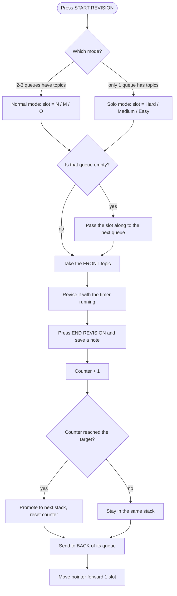

<div align="center">

# 🧠 ReWiseQuest

### One topic a day. Zero decisions.

A gamified spaced-revision tracker for Windows. It picks what you revise each day, brings new topics back often, and never lets old ones fade.

[](STORE_LINK_HERE)


**[⬇️ Download from the Microsoft Store](STORE_LINK_HERE)** · **[🎮 Try the live demo](WEBSITE_LINK_HERE)**

</div>

---

## 📖 Table of Contents

- [What is ReWiseQuest?](#-what-is-rewisequest)
- [Download](#%EF%B8%8F-download)
- [The big idea](#-the-big-idea)
- [Features](#-features)
- [How to use it](#-how-to-use-it)
- [How the rotation works](#%EF%B8%8F-how-the-rotation-works)
- [Gamification](#-gamification)
- [Settings and customisation](#%EF%B8%8F-settings-and-customisation)
- [Keyboard shortcuts](#%EF%B8%8F-keyboard-shortcuts)
- [Your data and privacy](#-your-data-and-privacy)
- [Trade-offs](#%EF%B8%8F-trade-offs)
- [Creator](#-creator)
- [License](#-license)

---

## 🎯 What is ReWiseQuest?

You have a pile of things to revise, and:

- The number of topics keeps changing. You add more all the time.
- You can only afford **one topic per day**.
- Fresh topics should come back **more often** than old ones.
- Old topics must **never be dropped**, only revisited less often.
- If you miss a day (or a week), nothing should break.

Most revision tools punish you for skipping: the backlog explodes and you quit. ReWiseQuest counts **revisions, not calendar dates**, so there is **no backlog, no guilt, and no angry red numbers**. Open the app, and today's topic is already waiting.

---

## ⬇️ Download

ReWiseQuest is distributed **exclusively through the Microsoft Store**.

<div align="center">

### [👉 Get ReWiseQuest on the Microsoft Store 👈](STORE_LINK_HERE)

</div>

1. Open the **Microsoft Store** link above (or the download button on the project website).
2. Click **Get** / **Install**.
3. Launch **ReWiseQuest** from the Start menu.

That's it. No account, no sign-up, no installer to hunt down. Updates are delivered through the Microsoft Store.

> The website only links to the Store listing, so the Store is always the one official place to download the app.

**Want to try before installing?** The website has a **live demo** that runs the real rotation engine in your browser. Press COMPLETED, add your own topics, pick a difficulty, and watch topics move from New to Medium to Old. (The demo resets when you refresh, and the full app adds subjects, timers, notes, streaks, history and reminders.)

---

## 💡 The big idea

Three rotating queues share your daily slots on a **3 : 2 : 2** pattern.

| Queue         | Purpose                           | Slots per 7-revision cycle |
| ------------- | --------------------------------- | :------------------------: |
| 🔴 **New**    | Where every topic starts          |           **3**            |
| 🟡 **Medium** | Topics that have stuck once       |           **2**            |
| 🟢 **Old**    | Known topics, kept alive for good |           **2**            |

Inside each queue, you revise the topic at the **front**, then it goes to the **back**.

A topic climbs **New → Medium → Old** as you revise it. How fast it climbs depends on the **difficulty you choose** for it:

| Difficulty | Revisions needed per stack | XP per revision |
| ---------- | :------------------------: | :-------------: |
| **Hard**   |             5              |       +30       |
| **Medium** |             4              |       +20       |
| **Easy**   |             3              |       +10       |

> **Example:** _Sliding Window_ (Hard) needs 5 revisions in New, then 5 more in Medium, then lands in Old and stays in rotation forever.

---

## ✨ Features

|     | Feature                       | What it means for you                                                                                   |
| --- | ----------------------------- | ------------------------------------------------------------------------------------------------------- |
| 🎯  | **One topic, zero decisions** | Open the app and your topic is waiting. All your energy goes into learning, not organising.             |
| 🔁  | **Smart rotation**            | Fresh material keeps coming back until it sticks, while older topics keep returning so they never fade. |
| 🧗  | **Hard / Medium / Easy**      | Tell the app how tough a topic feels and it adapts how long that topic stays in focus.                  |
| 📚  | **Unlimited subjects**        | Keep maths, languages, code and certifications completely separate, each with its own rhythm.           |
| ⏱️  | **Session timer**             | Time every revision and watch your total study time grow.                                               |
| 📝  | **Notes**                     | Pin a permanent note to a topic, and write "where I stopped" so tomorrow starts fast.                   |
| ⭐  | **XP, levels and streaks**    | Earn XP, level up, protect your streak, and fill your history calendar with colour.                     |
| 🔔  | **Daily reminders**           | A gentle nudge at the time you choose.                                                                  |
| 🎨  | **Six themes**                | Pick the colours that make you want to open it.                                                         |
| ↶   | **Undo**                      | Saved a revision by mistake? Undo it within 5 minutes.                                                  |
| ⏭️  | **Skip**                      | Not feeling a topic today? Skip it (up to 3 times in a row).                                            |
| 🔍  | **Zoom**                      | Scale the whole interface to suit your screen.                                                          |
| 🌗  | **Light and dark**            | Follows your Windows theme automatically.                                                               |
| 💾  | **Your save folder**          | Keep your data wherever you like, including OneDrive.                                                   |

---

## 🕹️ How to use it

1. **Pick a subject** from the Subject dropdown at the top (or click **+ ADD SUBJECT**).
2. **Add topics** in the pink _Add topic_ tile: type a name, optionally add a note, choose **Hard / Medium / Easy**, and press **ADD**. Every topic starts in **New**.
3. **Press START REVISION.** The big green tile shows today's topic and starts a timer. Go study it.
4. **Press END REVISION.** Optionally write where you stopped, then **SAVE & FINISH**. The topic goes to the back of its queue and you earn XP.
5. **Come back tomorrow.** The next revision unlocks at 12:00 AM. Missed a day? You simply carry on from the same spot.

### The main screen

| Tile                   | What it shows                                                                                                         |
| ---------------------- | --------------------------------------------------------------------------------------------------------------------- |
| **Header**             | Level + XP bar, streak, current mode, slot number, author info, settings, window controls                             |
| **Cycle strip**        | The 7 slots (N M N O N M O) with the current one highlighted, plus the **Undo** button                                |
| **Subject**            | Subject switcher and quick-add                                                                                        |
| **Today**              | The topic to revise, its notes, difficulty, progress pips, **Start/End**, **Skip**, **Edit**                          |
| **Add topic**          | Name, note and difficulty picker (adds to **New** only)                                                               |
| **Tools**              | **History**, **Set Reminders**, **How to Use**                                                                        |
| **New / Medium / Old** | Every topic in each queue with progress pips. The front topic is highlighted, and you can click any topic to edit it. |

### Editing a topic

Click any topic (or press **✎ EDIT** on the Today tile) to rename it, change its difficulty, edit or delete its notes, or delete the topic. Changing difficulty keeps the counter safely below the new target.

> Editing, deleting, adding or skipping a topic cancels **Undo**.

---

## ⚙️ How the rotation works

### The 7-slot pattern

```
Slot:   1   2   3   4   5   6   7   → repeat
        N   M   N   O   N   M   O
```

New topics are spread evenly through the cycle so they never go too long without a visit.

A single **pattern pointer** says which slot comes next, and it moves forward **only when you actually revise something**. That's why skipped days are free: the pointer follows your revisions, not the calendar.

### A revision, step by step



### Pass-along rule (empty queues)

If today's slot belongs to an empty queue, it goes to the next queue in line, so no day is wasted.

| Slot type   | Falls back to    |
| ----------- | ---------------- |
| New slot    | Medium, then Old |
| Medium slot | New, then Old    |
| Old slot    | Medium, then New |

### Two modes

The app picks the mode for you automatically.

**🟦 Normal mode** is active when **two or three** queues have topics. The 3:2:2 pattern runs across **New, Medium and Old**.

**🟪 Solo mode** is active when **only one** queue has topics (for example, everything has reached Old). The same 3:2:2 pattern now runs across that queue's **difficulty groups**, so harder topics come up more often:

| Group  | Slots per cycle |
| ------ | :-------------: |
| Hard   |        3        |
| Medium |        2        |
| Easy   |        2        |

Empty groups pass their slot along too (Hard → Medium → Easy). Whenever the mode switches, **the pattern restarts from slot 1**, and the strip changes from N M O to H M E.

### Skipped days vs. the Skip button

These are two different things:

- **Skipped days** mean you didn't open the app. That's totally free: no catch-up, no penalty, and every topic's gap just stretches equally.
- **The SKIP button** means you opened the app but don't want _this_ topic right now. It moves the topic to the back of its queue **without counting a revision**, and the slot does **not** advance. Each topic can be skipped **3 times in a row**, and revising it resets its skip counter.

### Walkthrough

1. You add **A** (Easy), **B** (Hard), **C** (Medium). Only New has topics, so you're in **Solo mode**: Hard gets 3 slots, Medium 2, Easy 2.
2. You see B (Hard) most often, because Hard has the most slots.
3. After 3 revisions, **A** is promoted to Medium. Now two queues have topics, so the app switches to **Normal mode** and the pattern restarts.
4. You add **D** (Hard). New gets its 3 slots per cycle again.
5. Eventually everything reaches Old. With only Old left, you're back in **Solo mode** and difficulty decides how often each topic appears.

### Behaviour over time

| Phase            | What happens                                               |
| ---------------- | ---------------------------------------------------------- |
| **Early**        | Only New has topics, so new material is revised daily      |
| **Middle**       | The 3:2:2 pattern runs in full across all three queues     |
| **Late**         | Everything sits in Old and difficulty steers what comes up |
| **Adding later** | New reclaims its 3 slots per cycle automatically           |

---

## 🎮 Gamification

| Feature           | Details                                                                                          |
| ----------------- | ------------------------------------------------------------------------------------------------ |
| **XP**            | Hard +30, Medium +20, Easy +10 per revision                                                      |
| **Levels**        | Every 100 XP is a level (shown in the header bar)                                                |
| **Streak**        | Consecutive days with at least one revision. Today doesn't break it until the day actually ends. |
| **Best streak**   | Your longest run ever, shown in History                                                          |
| **Heatmap**       | 18-week calendar. Darker green means more revisions that day.                                    |
| **Time tracking** | Every revision is timed. Total study time and your recent revisions show in History.             |

---

## 🛠️ Settings and customisation

Click your **name** (top right) to open Settings.

| Setting           | What it does                                                                                                               |
| ----------------- | -------------------------------------------------------------------------------------------------------------------------- |
| **Your name**     | Shown in the header, plus the avatar initial                                                                               |
| **Daily limit**   | **All subjects**: 1 revision a day in total. **Per subject**: 1 a day for each subject. Unlocks automatically at 12:00 AM. |
| **Theme**         | Classic, Ocean, Sunset, Forest, Berry, Desert (colours only)                                                               |
| **Save location** | Choose a folder, reset to the default, or reveal your save file                                                            |
| **Subjects**      | Rename or remove subjects. You always keep at least one.                                                                   |
| **Danger zone**   | Wipe everything (needs a second click to confirm)                                                                          |

### Notes

- **Topic note** (up to 250 characters): written when you add the topic. It stays until you edit or delete it. Great for formulas, hints or links to remember.
- **Left-off note** (up to 500 characters): written when you end a revision. Only the latest is kept, and it's shown the next time that topic comes up.

### Reminders

Turn on a daily reminder and pick a time. You get an **in-app popup** and a **system notification**. ReWiseQuest needs to be open (minimised is fine). It fires at your chosen time, or when you open the app within 2 hours after it, and no reminder is sent if you've already finished for the day.

---

## ⌨️ Keyboard shortcuts

| Keys                 | Action                                                         |
| -------------------- | -------------------------------------------------------------- |
| `Enter` / `Space`    | Start a revision (when you're not typing and no popup is open) |
| `Esc`                | Close the top-most popup                                       |
| `Ctrl` + `+` / `-`   | Zoom in / out (50% to 300%)                                    |
| `Ctrl` + `0`         | Reset zoom                                                     |
| `Ctrl` + mouse wheel | Zoom                                                           |

Your zoom level is remembered between launches.

---

## 🔒 Your data and privacy

**Your data is yours. Completely.**

- ❌ No account
- ❌ No ads
- ❌ No analytics
- ❌ No tracking
- ✅ Works fully **offline**
- ✅ Everything stays on **your own PC**, in a folder you choose

All your subjects, topics, notes, history, XP and settings live in **one local file**, saved automatically after every change. In **Settings → Save location** you can see exactly where it is, open it in Explorer, or move it to another folder (for example OneDrive, to back it up or share it between your own PCs).

**Safety nets built in:**

- 🩹 If a save file ever gets corrupted, it's set aside rather than overwritten.
- ⏳ If you close the app mid-revision, the revision (and its timer) is still there when you come back.
- 📁 Pointing to a folder that already has a save file asks whether to **load it** or **replace it**.
- 🔄 Data from earlier versions is carried over and upgraded automatically.

---

## ⚖️ Trade-offs

Worth knowing before you load up a big topic list:

- With one topic a day, the average gap between visits is roughly the **number of topics**. Giving New topics shorter gaps stretches Old ones.
- A big Old queue means long waits. With 2 Old slots per cycle, **10 Old topics wait about 5 weeks each**.
- Topics **never retire**, so Old only grows. If it gets too big, split things into separate subjects or delete topics you've truly mastered.

---

## 👤 Creator

**Aditya Singh** built ReWiseQuest because he wanted a revision system that decides for him and still keeps every old topic alive.

[🌐 Portfolio](https://aditya-singh.info/) · [GitHub](https://github.com/AdityaSingh21Official) · [LinkedIn](https://www.linkedin.com/in/aditya-singh-computer-science-virtuoso/)

---

## 📄 License

ReWiseQuest is **closed-source, proprietary software**. This repository contains documentation only, and the application source code is not published. The app is distributed through the Microsoft Store.

© 2026 Aditya Singh. All rights reserved.

---

<div align="center">

**[⬇️ Get ReWiseQuest on the Microsoft Store](STORE_LINK_HERE)**

_Stop wondering what to study next. Let every day count._ 🌱 → 🌿 → 🌳

</div>
